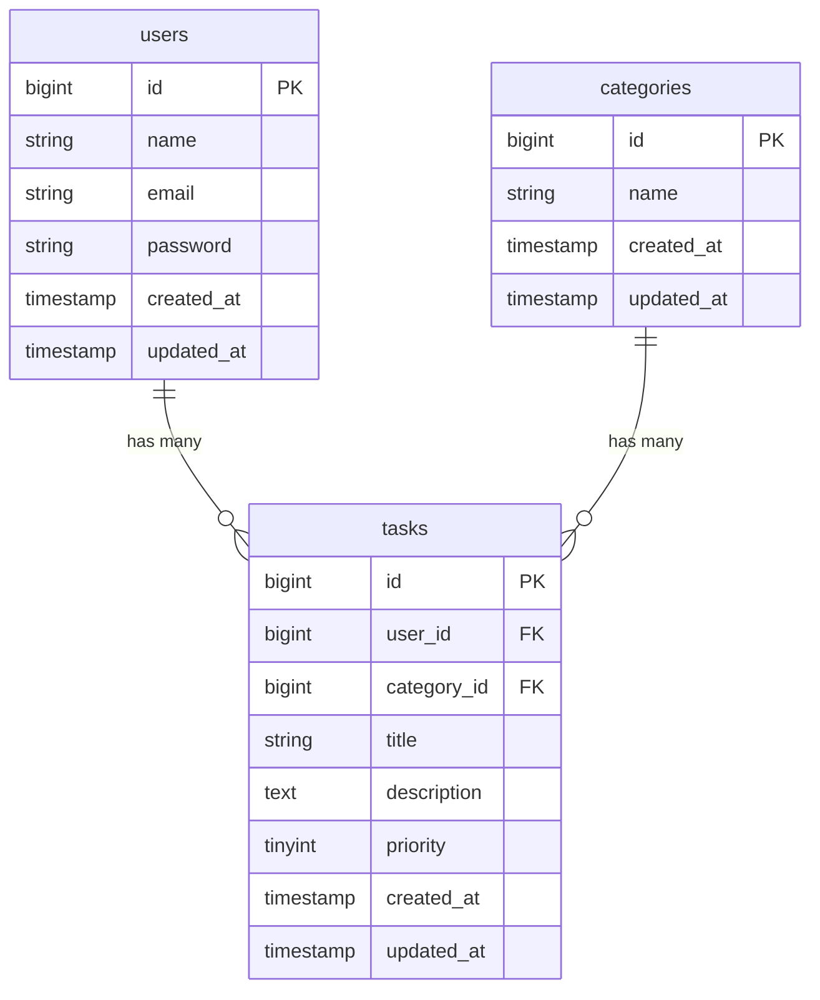

# タスク管理アプリ

## 概要

Laravelを使用して作成したタスク管理アプリケーションです。

ユーザー認証機能、タスク管理機能、カテゴリー管理機能を実装しています。また、タスク情報を取得する公開APIを提供しています。

## 作成者

COACHTECH 学習課題

## 使用技術

- PHP 8.5.8
- Laravel 10.50.4
- MySQL 8.4
- Laravel Fortify
- Laravel Sanctum
- Docker
- Laravel Sail
- Tailwind CSS 3.4.19
- Vite 5
- PHPUnit

## ER図



## 開発環境URL

- アプリケーション：http://localhost
- phpMyAdmin：http://localhost:8080
- Vite：http://localhost:5173

## 動作環境

- PHP 8.5.8
- Laravel 10.50.4
- MySQL 8.4
- Docker / Laravel Sail

## 環境構築手順

### 1. リポジトリをクローン

```bash
git clone git@github.com:53535taka/task-manager-app5.git
cd task-manager-app5
```

### 2. 環境設定ファイルを作成

```bash
cp .env.example .env
```

### 3. Composerパッケージをインストール

```bash
composer install
```

### 4. Dockerコンテナを起動

```bash
./vendor/bin/sail up -d
```

### 5. アプリケーションキーを生成

```bash
./vendor/bin/sail artisan key:generate
```

### 6. データベースのマイグレーション

```bash
./vendor/bin/sail artisan migrate
```

### 7. フロントエンドのパッケージをインストール

```bash
./vendor/bin/sail npm install
```

### 8. フロントエンドをビルド

```bash
./vendor/bin/sail npm run build
```

## テスト実行

```bash
./vendor/bin/sail test
```

## 機能一覧

### 認証機能

- ユーザー登録
- ログイン
- ログアウト
- 未認証ユーザーのアクセス制御

### カテゴリー管理機能

- カテゴリー一覧表示
- カテゴリー登録
- カテゴリー詳細表示
- カテゴリー編集
- カテゴリー削除

### タスク管理機能

- タスク一覧表示
- タスク登録
- タスク詳細表示
- タスク編集
- タスク削除
- タスクの優先度表示
    - 1：低
    - 2：中
    - 3：高

## API一覧

認証不要でタスク情報を取得できる公開APIです。

| HTTPメソッド | エンドポイント      | 機能           |
| ------------ | ------------------- | -------------- |
| GET          | `/api/tasks`        | タスク一覧取得 |
| GET          | `/api/tasks/{task}` | タスク詳細取得 |

### APIレスポンス項目

- `id`：タスクID
- `title`：タイトル
- `description`：説明
- `priority`：優先度の数値
- `priority_label`：優先度のラベル
- `category`：カテゴリー情報（ID・名前）
- `user`：ユーザー情報（ID・名前）
- `created_at`：作成日時
- `updated_at`：更新日時
